

  

<h1 align="center">PartnerOffice</h1>

Кабинет партнёра для работы с заказами Ozon

Кабинет региональных партнёров по заказам Ozon. Партнёры работают с заказами через проект [Studio2](https://github.com/EvgeniBondarev/Studio2Prod), а PartnerOffice даёт им отдельный интерфейс. Интерфейс повторяет привычный партнёрам рабочий инструмент «Турбо ПВЗ» (дизайн-система ozi): те же цвета, шрифт, сетка, формы, навигация и иконки, поэтому обучение не требуется.

Архитектура и план разработки: [docs/ARCHITECTURE.md](docs/ARCHITECTURE.md). Фронтенд партнёра: [web/README.md](web/README.md).

## Интерфейс

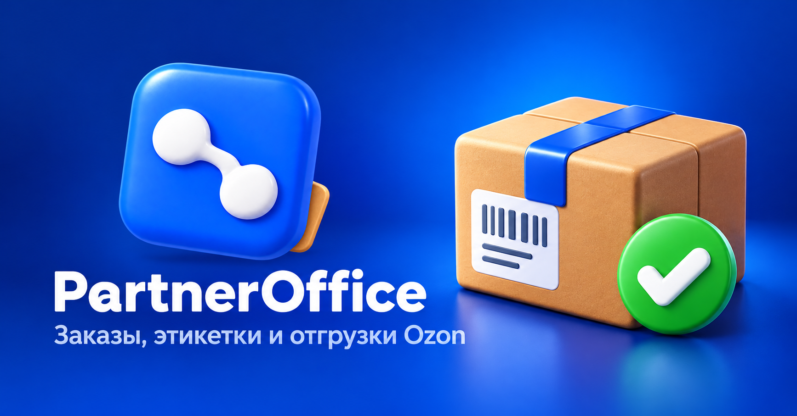

| Каркас приложения | Таблица заказов |
|---|---|
| 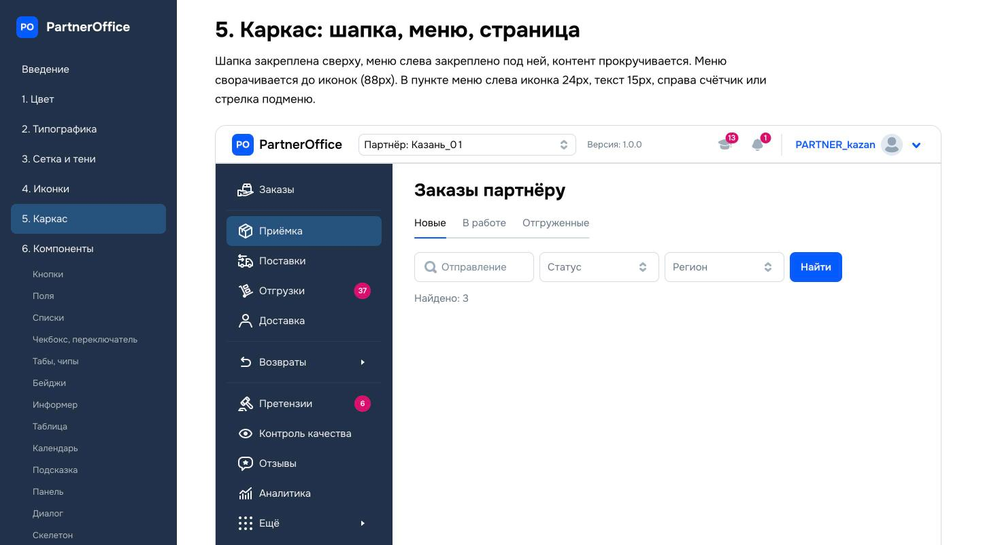 | 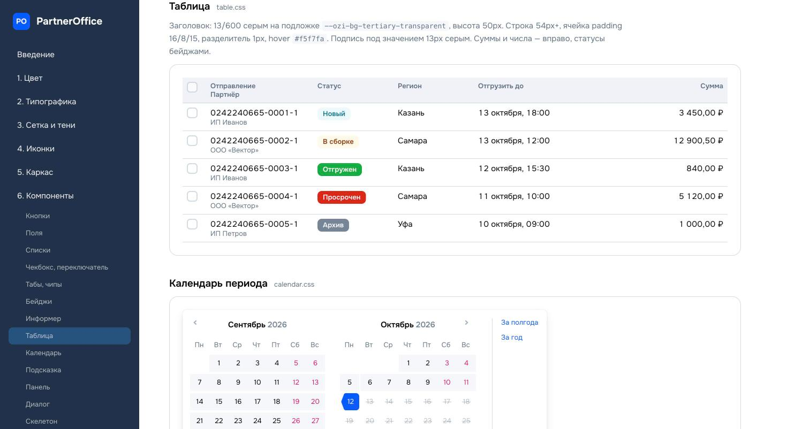 |
| Боковое меню, шапка и рабочая зона | Фильтры, статусы, действия и строки заказов |

| Поля и список | Панель заказа и диалог |
|---|---|
| 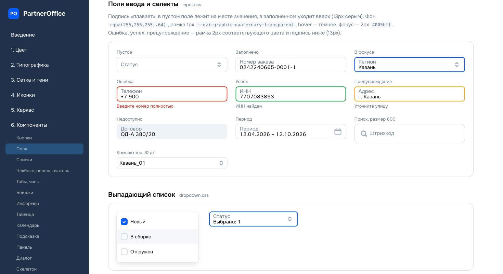 | 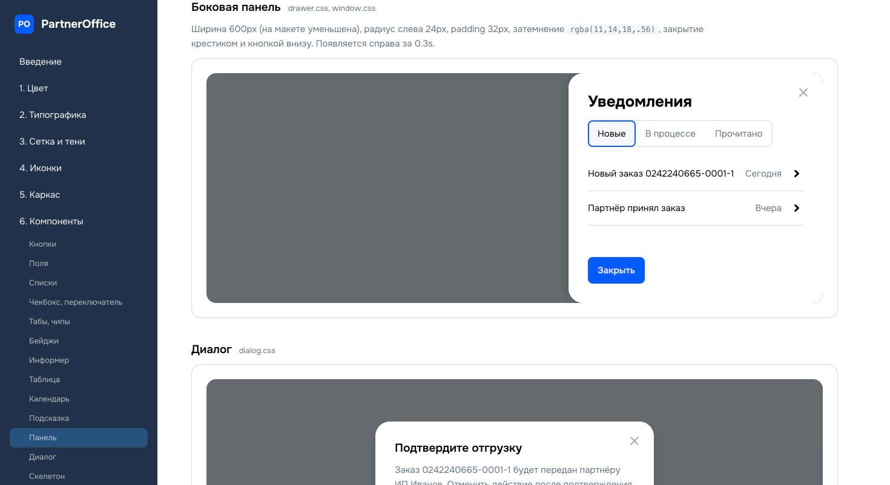 |
| Поиск, селекты и подсказки | Детали заказа и подтверждение действия |

Для пустых состояний, успеха, ошибок и печати этикеток используются собственные 3D‑иллюстрации в той же визуальной грамматике: мягкие формы, объём, чистые акцентные цвета и компактная метафора действия.

## Брендбук

**[Исходник страницы брендбука](design/brandbook/index.html)** (на GitHub открывается как код; чтобы увидеть страницу, скачайте репозиторий и откройте файл в браузере)

Локально: откройте `design/brandbook/index.html` или выполните `python3 -m http.server` из папки `design` и перейдите на `/brandbook/index.html`. Пересборка: `python3 design/build/build_brandbook.py`.

### Скриншоты дизайн-системы

| | |
|---|---|
| 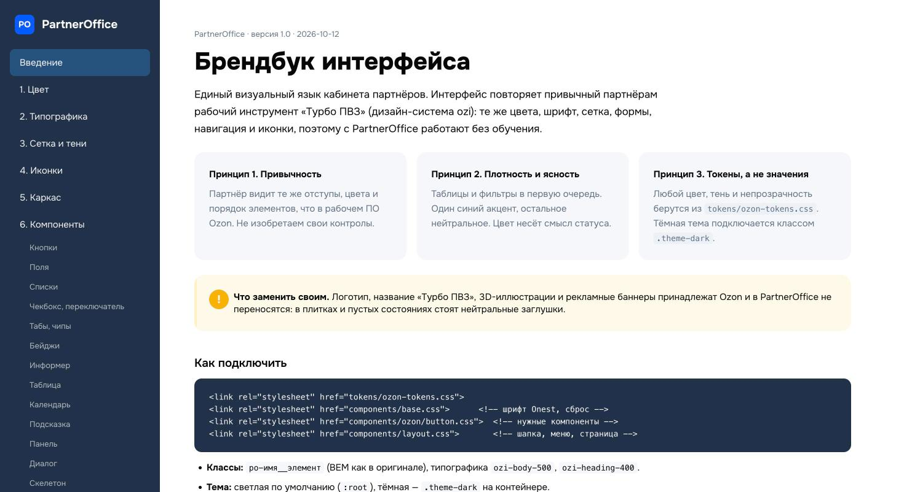 Введение и принципы | 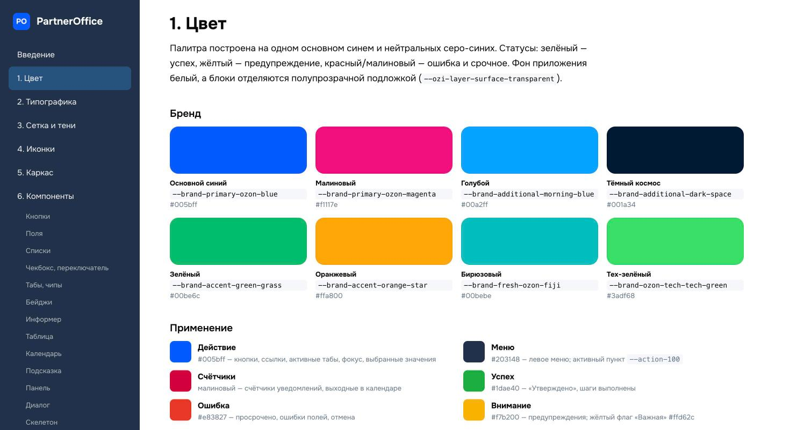 Цвет: бренд и применение |
| 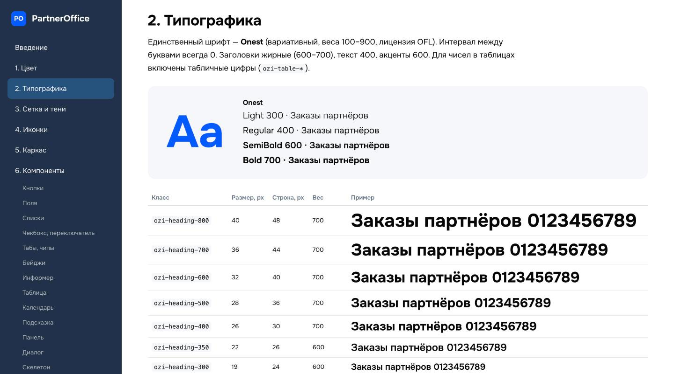 Типографика (Onest) |  Каркас: шапка, меню, страница |
| 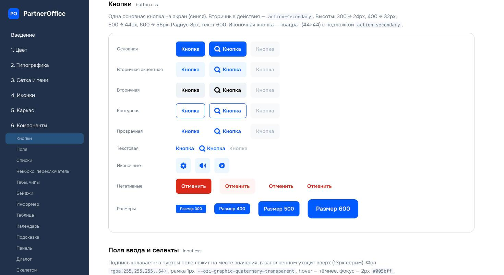 Кнопки |  Поля ввода и выпадающий список |
|  Таблица | 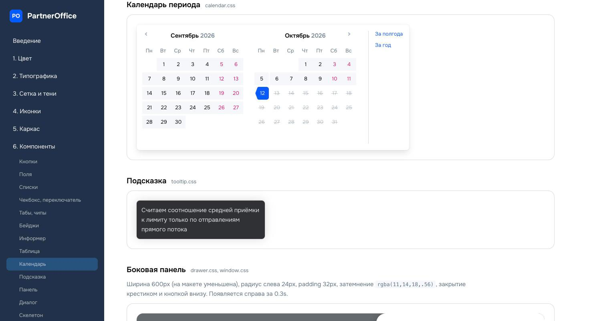 Календарь периода и подсказка |
|  Боковая панель и диалог | 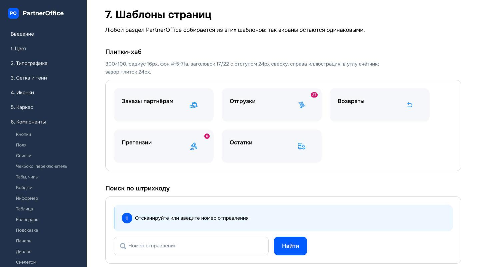 Шаблоны страниц |
| 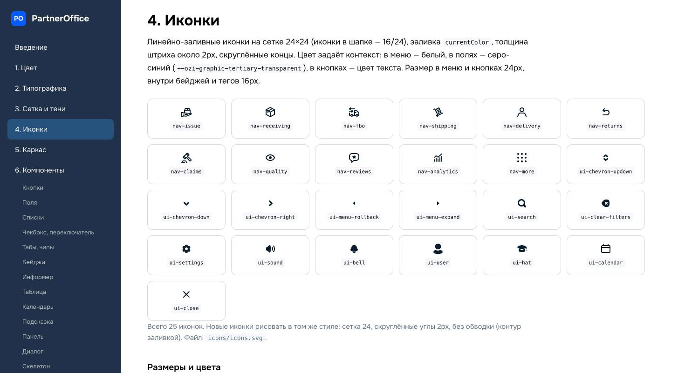 Иконки | |

## Что в репозитории

| Папка | Содержимое |
|---|---|
| `design/brandbook/` | Брендбук интерфейса (цвет, типографика, сетка, иконки, каркас, компоненты, шаблоны, правила) |
| `design/tokens/` | Дизайн-токены: 316 переменных `:root`, светлая и тёмная тема |
| `design/components/` | `base.css`, `layout.css`, `dropdown.css`, `checkbox.css`, `calendar.css`, демо; `ozon/` — 25 файлов компонентов |
| `design/fonts/` | Onest 2.0 (вариативный, лицензия OFL) |
| `design/icons/` | Спрайт иконок `icons.svg` |
| `design/build/` | Генератор брендбука |
| `design/RESEARCH.md` | Сводка исследования оригинала: цвета, размеры, состояния, маршруты |
| `docs/screenshots/` | Скриншоты брендбука |

Подробности и порядок подключения: [design/README.md](design/README.md).

## Что нельзя переносить

Логотип, название «Турбо ПВЗ», оригинальные 3D-иллюстрации и рекламные баннеры Ozon не переносятся в PartnerOffice. Проект использует собственный логотип и самостоятельные иллюстрации. Скриншоты и исходные CSS оригинала в репозиторий не входят: на скриншотах реальные данные пункта выдачи.

## Статус

- Готово: токены, компоненты, брендбук.
- Не снято с оригинала: тёмная тема в виде страниц, формы действий и toast-уведомления, выбор месяца и года в календаре, мобильные ширины (<900px сверены только по CSS).
- Дальше: экраны PartnerOffice (заказы партнёру, карточка заказа, отгрузки) и интеграция с данными Studio2.
