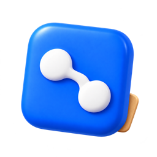
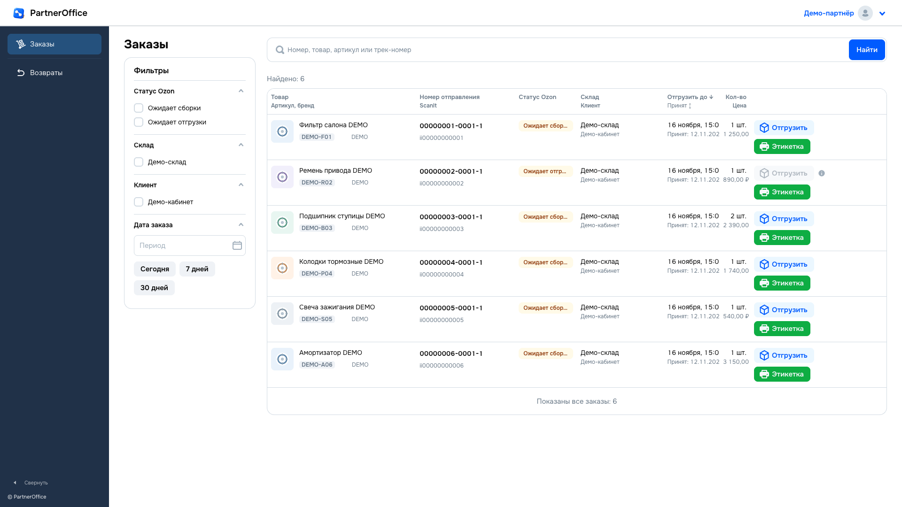
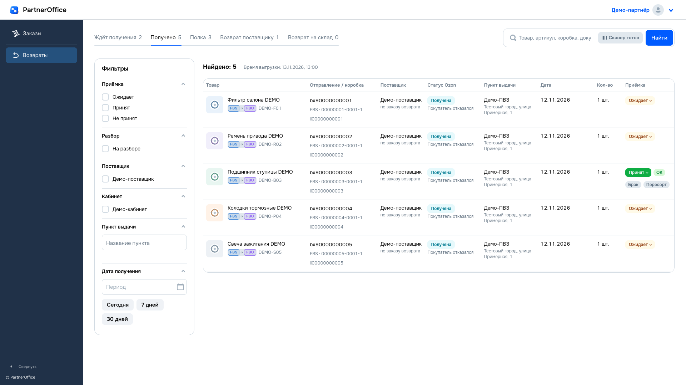
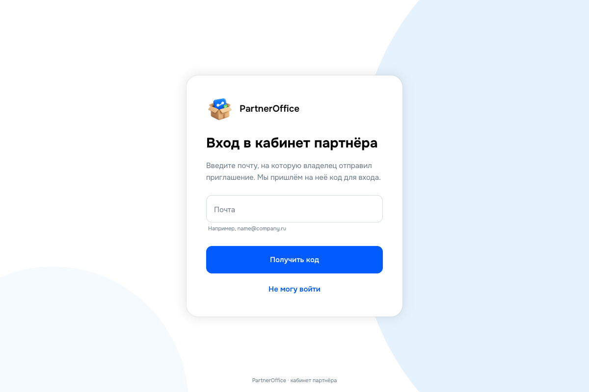

<p align="center">
  
</p>

<h1 align="center">PartnerOffice</h1>

<p align="center">Кабинет партнёра для работы с заказами и возвратами Ozon</p>

PartnerOffice помогает партнёрам обрабатывать заказы и возвраты в одном интерфейсе. Кабинет получает доступные партнёру данные и выполняет действия через [Studio 2](https://github.com/EvgeniBondarev/Studio2Prod); данные о возвратах поступают из сервиса [ozon-returns](https://github.com/ganzda-cyber/ozon-returns). Доступ к данным и операциям определяется настройками партнёра в Studio 2.

## Возможности

- **Заказы:** поиск и фильтры по статусу, складу, кабинету и дате; карточка заказа; сборка, отгрузка и печать этикетки при наличии соответствующих прав.
- **Возвраты:** разделы «Ждёт получения», «Получено», «Полка», «Возврат поставщику» и «Возврат на склад»; статусы Ozon, пункт выдачи, история и фильтры.
- **Приёмка:** ручная отметка статуса, «Брак» или «Пересорт» с комментарием и фотографиями; работа со сканером в разделе «Получено» при разрешённой приёмке.
- **Поиск:** результаты обновляются при вводе с короткой задержкой, доступны подсказки и применение через Enter или кнопку «Найти».
- **Разбор возвратов:** принятые позиции попадают в очередь сотрудников; партнёр видит подтверждение, а дальнейшее решение отображается в соответствующем разделе.
- **Адаптивный интерфейс:** таблицы и фильтры рассчитаны на широкие экраны; на узких экранах возвраты отображаются карточками, а фильтры открываются отдельно.

## Интерфейс

Скриншоты сняты с локально запущенного приложения. **Все товары, партнёр, адреса, номера и изображения на них вымышлены**; ответы API заменены демонстрационными данными.

### Заказы

Поиск, фильтры и действия по заказам в одном списке.



### Полученные возвраты

Связанные FBS/FBO-позиции, штрихкоды, пункт выдачи и отметки приёмки.



### Вход в кабинет

Вход по электронной почте и одноразовому коду из письма.



## Как устроена работа с возвратами

На вкладке «Получено» партнёр может отметить приёмку вручную или отсканировать код. При сканировании приложение запрашивает точное совпадение и принимает позицию только при единственном результате и полном ответе сервиса. Ручной ввод, Enter и кнопка «Найти» применяют поиск. Быстрый ввод распознаётся по скорости, поэтому вставка кода или очень быстрый набор могут восприниматься как сканирование.

Связанные FBS/FBO-возвраты показывают номер отправления и доступные штрихкоды обеих частей. Для некоторых искажений ввода сканера поддерживаются варианты кода, в том числе потерянная буква `i` в начале `ii`-кода. При неоднозначном сопоставлении позицию нужно проверить вручную.

После приёмки позиция может попасть на разбор сотрудников в ozon-returns. Подтверждённая постановка сопровождается уведомлением в кабинете; сотрудникам показывается уведомление до закрытия, а Studio 2 отправляет сообщение в Telegram. Фактическая доступность операций зависит от разрешений и состояния сервисов. Подробнее: [раздел «Получено» в документации фронтенда](web/README.md#раздел-получено-и-ждёт-получения-поиск-сверху-фильтры-в-панели).

## Локальный запуск

Нужны Node.js и npm. Для работы с реальными данными требуется доступный API Studio 2 и настроенный тестовый партнёр.

```bash
cd web
npm ci
npm run dev
```

По умолчанию Vite открывает приложение на `http://localhost:5173` и проксирует `/partner-api` в локальную Studio 2 на `http://localhost:5012`. Адрес бэкенда и другие варианты настройки описаны в [web/README.md](web/README.md#api-разработка-и-прод).

```bash
npm run typecheck  # проверка TypeScript
npm test           # тесты фронтенда
npm run build      # проверка типов и production-сборка
```

## Структура и документация

| Путь | Содержимое |
|---|---|
| [`web/`](web/) | React + TypeScript + Vite: страницы, API-клиент, компоненты и тесты |
| [`design/`](design/) | Дизайн-токены, компоненты, шрифты и иконки |
| [`docs/screenshots/app/`](docs/screenshots/app/) | Скриншоты интерфейса с вымышленными данными |
| [`deploy/`](deploy/) | Конфигурация контейнера и прокси |
| [`docs/ARCHITECTURE.md`](docs/ARCHITECTURE.md) | Архитектурные принципы и исходный план проекта |
| [`docs/DEPLOY.md`](docs/DEPLOY.md) | Развёртывание, CI/CD и диагностика |
| [`web/README.md`](web/README.md) | Запуск фронтенда, API и описание разделов |

Архитектурный документ содержит также первоначальный план и не все его пункты отражают текущее состояние. Актуальные возможности интерфейса описаны выше и в документации фронтенда.
