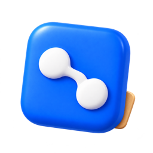
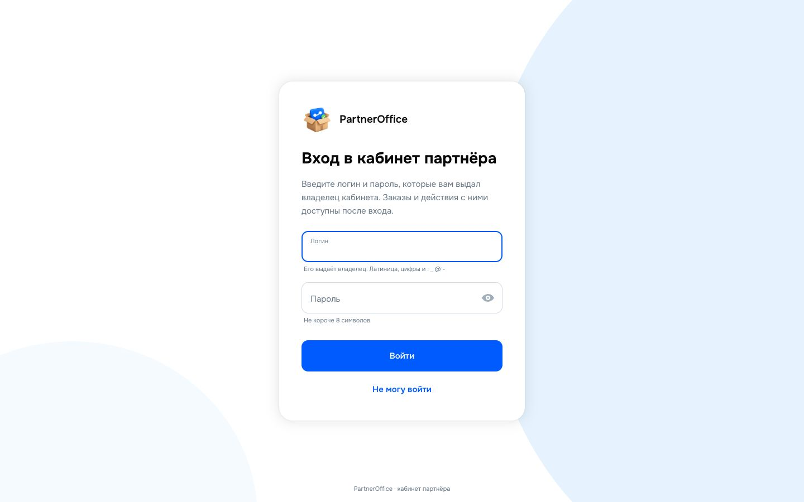
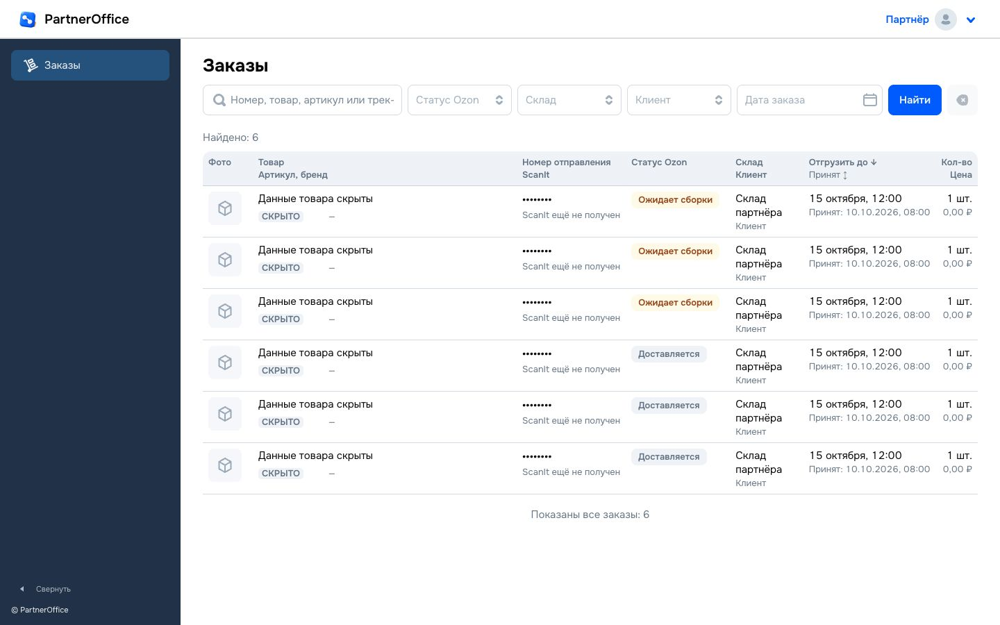

  

<h1 align="center">PartnerOffice</h1>

Кабинет партнёра для работы с заказами Ozon

Кабинет региональных партнёров по заказам Ozon. Партнёры работают с заказами через проект [Studio2](https://github.com/EvgeniBondarev/Studio2Prod), а PartnerOffice даёт им отдельный интерфейс.

Архитектура и план разработки: [docs/ARCHITECTURE.md](docs/ARCHITECTURE.md). Фронтенд партнёра: [web/README.md](web/README.md). Выкладка и сервер: [docs/DEPLOY.md](docs/DEPLOY.md).

## Интерфейс

| Вход в кабинет | Заказы |
|---|---|
|  |  |
| Вход по выданным владельцем реквизитам | Фильтры, статусы и таблица заказов |

Скриншоты сделаны на локальной сборке приложения. Данные на странице заказов заменены заглушками.

## Что в репозитории

| Папка | Содержимое |
|---|---|
| `design/tokens/` | Дизайн-токены: 316 переменных `:root`, светлая и тёмная тема |
| `design/components/` | `base.css`, `layout.css`, `dropdown.css`, `checkbox.css`, `calendar.css`, демо; `ozon/` — 25 файлов компонентов |
| `design/fonts/` | Onest 2.0 (вариативный, лицензия OFL) |
| `design/icons/` | Спрайт иконок `icons.svg` |
| `design/RESEARCH.md` | Сводка исследования оригинала: цвета, размеры, состояния, маршруты |
| `docs/screenshots/app/` | Скриншоты работающего приложения для README |

Подробности и порядок подключения: [design/README.md](design/README.md).

## Статус

- Готово: вход, список заказов, карточка заказа, отгрузка и печать этикеток.
- Таблица заказов и фильтры адаптируются к ширине экрана; на узких устройствах таблица прокручивается внутри рабочей области.
